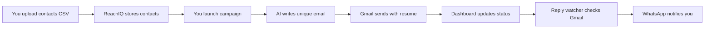
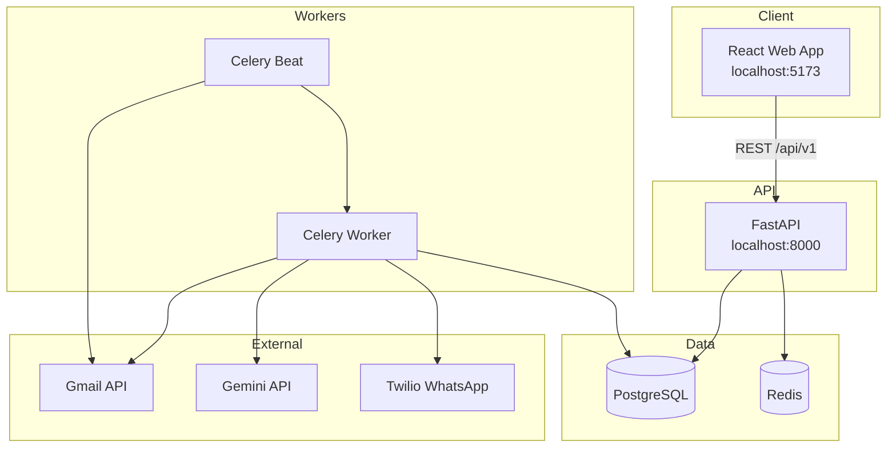

# ReachIQ

**Smart, personalised job outreach — powered by AI, sent from your Gmail, tracked in one dashboard.**

ReachIQ is a personal job-search automation platform. It helps you reach recruiters and HR contacts at scale without copy-pasting the same email hundreds of times. You upload a list of contacts, attach your resume, and ReachIQ writes a unique email for each person, sends it safely from your own Gmail account, and notifies you on WhatsApp when someone replies.

---

## Table of Contents

- [What Is ReachIQ?](#what-is-reachiq)
- [The Problem It Solves](#the-problem-it-solves)
- [Who Is It For?](#who-is-it-for)
- [How It Saves You Time](#how-it-saves-you-time)
- [How It Works (Simple Explanation)](#how-it-works-simple-explanation)
- [Key Features](#key-features)
- [User Journey & Workflows](#user-journey--workflows)
- [Technical Architecture](#technical-architecture)
- [Tech Stack](#tech-stack)
- [Project Structure](#project-structure)
- [How It Is Implemented](#how-it-is-implemented)
- [Safety & Limits](#safety--limits)
- [Getting Started](#getting-started)
- [Environment Variables](#environment-variables)
- [API Overview](#api-overview)
- [Frontend Pages](#frontend-pages)
- [Future Ideas](#future-ideas)
- [License & Author](#license--author)

---

## What Is ReachIQ?

Imagine you are job hunting and you have a spreadsheet of 100 recruiters — names, emails, and companies. Normally you would:

1. Open Gmail
2. Write a slightly different email for each person
3. Attach your resume
4. Hit send
5. Repeat 100 times
6. Check your inbox constantly for replies

That can take **many hours** and is mentally exhausting.

**ReachIQ automates the repetitive parts** while keeping emails personal and professional. It uses artificial intelligence (Google Gemini) to write a tailored message for each recruiter, sends emails through **your real Gmail account** (so replies come back to you normally), and gives you a clean web dashboard to track who was contacted, who replied, and what went wrong.

Think of it as a **personal outreach assistant** — not a spam tool. It is built for one job seeker running their own campaign, with built-in limits so Gmail stays safe.

---

## The Problem It Solves

| Pain point (manual job search) | How ReachIQ helps |
|-------------------------------|-------------------|
| Writing 50–100 similar emails by hand | AI generates a unique email per contact in seconds |
| Forgetting who you already emailed | Dashboard shows status: pending, sent, replied, failed |
| Missing a recruiter reply in a crowded inbox | WhatsApp alert the moment someone responds |
| Sending too fast and triggering Gmail spam filters | Random 30–90 second delays + daily send cap (60/day) |
| No central place to manage outreach | One web app: contacts, campaign, replies, settings |
| Re-attaching resume every time | Resume path saved once; attached automatically |

**In plain terms:** ReachIQ turns a slow, repetitive, error-prone process into a guided workflow you can start in under two minutes.

---

## Who Is It For?

- **Job seekers** applying to many companies via cold email to recruiters or HR
- **Developers and engineers** who want a structured outreach pipeline
- **Anyone** tired of manually personalising the same outreach message

It is **not** designed for bulk marketing, unsolicited mass mail, or sending without permission. It is a personal productivity tool for legitimate job search outreach.

---

## How It Saves You Time

### Before ReachIQ (manual)

| Task | Approx. time per contact | 100 contacts |
|------|-------------------------|--------------|
| Research + write email | 5–10 minutes | 8–16 hours |
| Attach resume + send | 1–2 minutes | 2–3 hours |
| Track in spreadsheet | ongoing | 1+ hour |
| Check inbox for replies | multiple times/day | daily habit |

**Total:** Easily **10–20+ hours** for 100 personalised emails, spread over days.

### With ReachIQ

| Task | Time |
|------|------|
| Connect Gmail (one time) | ~2 minutes |
| Upload CSV + resume path | ~1 minute |
| Launch campaign | 1 click |
| AI + send queue | Runs in background |
| Get WhatsApp on reply | Instant |

**Your active time:** roughly **under 5 minutes** to start a campaign. The system handles writing, sending, delays, and reply detection while you focus on interviews and applications elsewhere.

---

## How It Works (Simple Explanation)



1. **You connect Gmail** — ReachIQ gets permission to send emails and read threads for reply detection only.
2. **You upload contacts** — A CSV file with columns like `name`, `email`, `company`.
3. **You set your resume** — A PDF path on your computer (attached to every email).
4. **You launch** — ReachIQ queues emails in the background.
5. **For each contact** — AI writes a custom subject and body → waits a random delay → sends via Gmail with your resume.
6. **Every 5 minutes** — A background job checks Gmail for replies.
7. **When someone replies** — You get a WhatsApp message and the reply appears in the Replies page.

---

## Key Features

### Web dashboard (5 main pages)

| Page | What you do there |
|------|-------------------|
| **Dashboard** | See stats (pending, sent, replied), progress bar, recent activity |
| **Contacts** | Search, filter, delete contacts; export CSV |
| **Campaign** | Upload CSV, set resume, choose batch size, launch/pause |
| **Replies** | Read reply previews; see reply rate |
| **Settings** | Gmail connection, WhatsApp info, default preferences |

### Smart email generation

- Uses **Google Gemini** to write formal, professional outreach emails
- Each email references the **company name** specifically
- Output is structured JSON: `subject` + `body`
- Under ~200 words, with a clear call-to-action

### Safe sending

- **Max 60 emails per day** per campaign (configurable in backend)
- **30–90 second random delay** between sends (looks human, avoids spam flags)
- Sends from **your Gmail** — recipients see your real address
- **Pause / Resume** campaign controls via Redis flag

### Reply detection

- Background worker polls Gmail every **5 minutes**
- Matches replies to original threads
- Updates contact status to `replied`
- Sends **WhatsApp notification** with name, company, and preview

### Onboarding wizard

Three quick steps: Connect Gmail → Upload resume → Import contacts CSV.

---

## User Journey & Workflows

### Workflow 1 — First-time setup

```
Landing page → Onboarding (3 steps) → Dashboard
```

1. **Step 1:** Connect Gmail (OAuth in browser)
2. **Step 2:** Upload resume PDF or set file path
3. **Step 3:** Upload contacts CSV
4. Mark onboarding complete → enter main app

### Workflow 2 — Launch a campaign

```
Campaign page → Upload contacts (if needed) → Set resume path → Choose batch size → Launch
```

1. User selects how many emails to send today (10 / 30 / 50)
2. Confirmation modal shows summary (contacts, resume, estimate)
3. Backend creates `Campaign` + `EmailJob` rows
4. Celery tasks queued: one task per contact
5. Toast: "Campaign launched! N emails queued."

### Workflow 3 — Single email send (background)

```
Celery worker picks job → Check daily limit → Random delay → Gemini generates email → Gmail sends → Update DB
```

- Contact status: `pending` → (job `processing`) → `sent`
- Gmail thread ID saved for reply matching
- Daily send counter incremented

### Workflow 4 — Reply detected

```
Celery Beat (every 5 min) → Check Gmail threads → Match reply → Update contact → WhatsApp notify
```

- Contact status: `sent` → `replied`
- Reply preview stored in database
- User sees update on Replies page + bell badge in header

### Workflow 5 — Failure handling

- Failed sends retry with backoff (5 min → 30 min → dead)
- Dead jobs trigger WhatsApp alert
- Failed/dead counts visible on Dashboard

---

## Technical Architecture



| Layer | Role |
|-------|------|
| **React frontend** | UI, forms, live stats, React Query for API polling |
| **FastAPI backend** | REST API, auth, business logic |
| **PostgreSQL** | Contacts, campaigns, email jobs, Gmail tokens |
| **Redis** | Celery broker, result backend, campaign pause flag |
| **Celery worker** | Sends emails asynchronously |
| **Celery Beat** | Schedules reply watcher every 300 seconds |
| **Gmail API** | OAuth, send email, read threads |
| **Gemini API** | Generate personalised email content |
| **Twilio** | WhatsApp notifications |

---

## Tech Stack

### Backend

| Technology | Purpose |
|------------|---------|
| **Python 3.11** | Core language |
| **FastAPI** | HTTP API framework |
| **SQLAlchemy** | Database ORM (sync) |
| **PostgreSQL 15** | Persistent storage |
| **Alembic** | Database migrations |
| **Celery** | Background task queue |
| **Redis** | Message broker + cache |
| **Pydantic v2** | Request/response validation |
| **google-genai** | Gemini AI integration |
| **google-api-python-client** | Gmail API |
| **Twilio SDK** | WhatsApp messages |

### Frontend

| Technology | Purpose |
|------------|---------|
| **React 18** | UI library |
| **Vite** | Build tool and dev server |
| **TailwindCSS** | Styling (utility-first) |
| **React Router v6** | Page routing |
| **TanStack React Query** | API data fetching + polling |
| **Axios** | HTTP client |
| **Lucide React** | Icons |

### DevOps / Local

| Tool | Purpose |
|------|---------|
| **Uvicorn** | ASGI server |
| **Docker Compose** (optional) | Postgres + Redis + pgAdmin |
| **pytest** | Backend tests |

---

## Project Structure

```
ReachIQ/
├── backend/
│   ├── main.py                 # FastAPI app entry
│   ├── database.py             # SQLAlchemy session
│   ├── core/
│   │   └── config.py           # Settings from .env
│   ├── models/
│   │   └── models.py           # Campaign, Contact, EmailJob, etc.
│   ├── schemas/
│   │   └── schemas.py          # Pydantic API schemas
│   ├── routes/
│   │   ├── auth.py             # Gmail OAuth
│   │   ├── contacts.py         # CSV upload, list, delete
│   │   ├── campaigns.py        # Start, pause, resume, status
│   │   ├── emails.py           # Replies, sent, failed lists
│   │   └── resume.py           # Resume PDF upload
│   ├── services/
│   │   ├── gemini_service.py   # AI email generation
│   │   ├── gmail_service.py    # Gmail send + reply check
│   │   └── twilio_service.py   # WhatsApp notifications
│   └── workers/
│       ├── celery_app.py       # Celery configuration
│       ├── email_worker.py     # Send one email task
│       └── reply_watcher.py    # Poll Gmail for replies
├── frontend-web/
│   └── src/
│       ├── pages/              # Dashboard, Contacts, Campaign, Replies, Settings
│       ├── components/         # AppShell, StatusBadge, Toast, etc.
│       ├── lib/                # API client, formatters, settings
│       └── context/            # Toast provider
├── alembic/                    # Database migrations
├── scripts/
│   ├── start_dev.sh            # Start API locally
│   └── smoke_test.py           # Health checks
├── requirements.txt
├── .env.example
└── README.md                   # This file
```

---

## How It Is Implemented

### Database models (core entities)

| Model | Description |
|-------|-------------|
| **Campaign** | A batch of outreach (name, status: draft/running) |
| **Contact** | One recruiter/HR person (email, name, company, status) |
| **EmailJob** | One send attempt for one contact in one campaign |
| **DailySendLog** | Tracks emails sent per campaign per day |
| **GmailAuth** | Stored OAuth tokens for Gmail API |

**Contact statuses:** `pending` → `sent` → `replied` (or job-level `failed` / `dead`)

### AI email generation

The Gemini service builds a prompt with:

- Recipient name and company
- Your name (from `CANDIDATE_NAME` in `.env`)
- Rules: formal tone, company-specific opening, no generic filler, JSON output only

If Gemini returns invalid JSON, the job is marked failed with reason `ai_parse_error`.

### Gmail integration

- OAuth 2.0 flow: user clicks "Connect Gmail" → Google consent → tokens stored in DB
- Sends HTML/plain email with PDF resume attachment
- Saves `gmail_thread_id` for reply matching
- Reply watcher reads thread updates without accessing unrelated mail

### Queue system

- **Start campaign** → creates jobs → `send_email_job.delay(...)` for each contact
- Worker processes one contact at a time per task
- **Pause:** Redis key `campaign:paused` stops new processing
- **Resume:** clears the key

### Frontend data polling

| Page | Endpoint | Refresh interval |
|------|----------|------------------|
| Dashboard stats | `/campaigns/status` | 8 seconds |
| Contacts | `/contacts` | 15–20 seconds |
| Replies | `/emails/replies` | 15 seconds |
| Live activity (Campaign) | `/contacts` | 5 seconds while sending |

---

## Safety & Limits

| Rule | Value | Why |
|------|-------|-----|
| Daily email limit | 60 (default) | Protect Gmail reputation |
| Delay between sends | 30–90 seconds (random) | Mimic human sending |
| Max retries per job | 3 | Avoid infinite loops |
| Reply check interval | 300 seconds | Balance API usage vs speed |
| Batch size on launch | 10 / 30 / 50 (user choice) | Control daily volume |

These limits exist because **sending too fast from a personal Gmail account can get you flagged as spam**. ReachIQ is designed to be steady and sustainable.

---

## Getting Started

### Prerequisites

- Python 3.11+
- Node.js 18+
- PostgreSQL 15
- Redis
- Google Cloud project (Gmail API + OAuth credentials)
- Gemini API key
- Twilio account (WhatsApp sandbox or approved number)

### 1. Clone and configure

```bash
git clone <your-repo-url>
cd ReachIQ
cp .env.example .env
# Edit .env with your API keys and database URLs
```

### 2. Backend setup

```bash
python3 -m venv .venv
source .venv/bin/activate
pip install -r requirements.txt
alembic upgrade head
```

### 3. Start services

**Terminal 1 — API:**

```bash
./scripts/start_dev.sh
# API: http://localhost:8000
# Docs: http://localhost:8000/docs
```

**Terminal 2 — Celery worker:**

```bash
source .venv/bin/activate
celery -A backend.workers.celery_app worker -l info
```

**Terminal 3 — Celery Beat (reply watcher):**

```bash
source .venv/bin/activate
celery -A backend.workers.celery_app beat -l info
```

**Terminal 4 — Frontend:**

```bash
cd frontend-web
npm install
npm run dev
# App: http://localhost:5173
```

### 4. First run

1. Open `http://localhost:5173`
2. Complete onboarding (Gmail + resume + CSV)
3. Go to **Campaign** → Launch
4. Watch **Dashboard** and **Replies**

---

## Environment Variables

Copy `.env.example` to `.env` and fill in:

| Variable | Description |
|----------|-------------|
| `DATABASE_URL` | PostgreSQL connection string |
| `REDIS_URL` | Redis connection |
| `CELERY_BROKER_URL` | Celery broker (usually Redis) |
| `CELERY_RESULT_BACKEND` | Celery results (usually Redis) |
| `GEMINI_API_KEY` | Google AI Studio API key |
| `GEMINI_MODEL` | Model name (e.g. `gemini-2.5-flash`) |
| `CANDIDATE_NAME` | Your name in AI emails |
| `GMAIL_CLIENT_ID` | Google OAuth client ID |
| `GMAIL_CLIENT_SECRET` | Google OAuth secret |
| `GMAIL_REDIRECT_URI` | OAuth callback URL |
| `TWILIO_ACCOUNT_SID` | Twilio account SID |
| `TWILIO_AUTH_TOKEN` | Twilio auth token |
| `TWILIO_WHATSAPP_FROM` | Twilio WhatsApp sender |
| `TWILIO_WHATSAPP_TO` | Your WhatsApp number |
| `SECRET_KEY` | App secret (32+ chars) |

---

## API Overview

Base URL: `http://localhost:8000/api/v1`

| Method | Endpoint | Description |
|--------|----------|-------------|
| GET | `/health` | API + DB health (root, not under v1) |
| GET | `/auth/gmail` | Start Gmail OAuth |
| GET | `/auth/gmail/status` | Connection status |
| GET | `/contacts` | List all contacts |
| POST | `/contacts/upload` | Upload CSV |
| DELETE | `/contacts/{id}` | Delete contact |
| POST | `/resume/upload` | Upload resume PDF |
| GET | `/campaigns/status` | Pipeline counts |
| POST | `/campaigns/start` | Launch campaign |
| POST | `/campaigns/pause` | Pause sending |
| POST | `/campaigns/resume` | Resume sending |
| GET | `/emails/replies` | List replied contacts |

Interactive docs: **http://localhost:8000/docs**

---

## Frontend Pages

| Route | Page |
|-------|------|
| `/` | Landing — marketing hero |
| `/onboarding` | 3-step setup wizard |
| `/dashboard` | Stats, progress, activity |
| `/contacts` | Full contact table |
| `/campaign` | Upload, launch, live feed |
| `/replies` | Reply cards + rate stats |
| `/settings` | Gmail, WhatsApp, defaults |

**Design:** Instrument Serif headings, Inter body, brand colour `#4F46E5`, light lavender background `#F8F7FF`.

---

## Future Ideas

- Multi-user auth and teams
- Email templates and A/B testing
- LinkedIn integration
- Scheduled campaigns (send at 9 AM only)
- Analytics: best-performing subject lines
- Mobile app (React Native / Expo scaffold planned)

---

## License & Author

This project is a personal job-search automation tool built as a portfolio / productivity project.

**ReachIQ v1.0** — Send smarter. Land interviews.

---

### Quick summary (for GitHub profile / README badge section)

> **ReachIQ** automates personalised cold outreach for job seekers. Upload recruiter contacts, let AI write unique emails, send safely from Gmail with smart delays, and get WhatsApp alerts when recruiters reply — all from one dashboard. Saves hours of manual copy-paste work per campaign.
